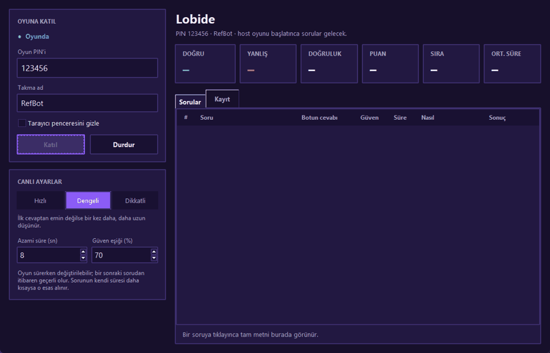
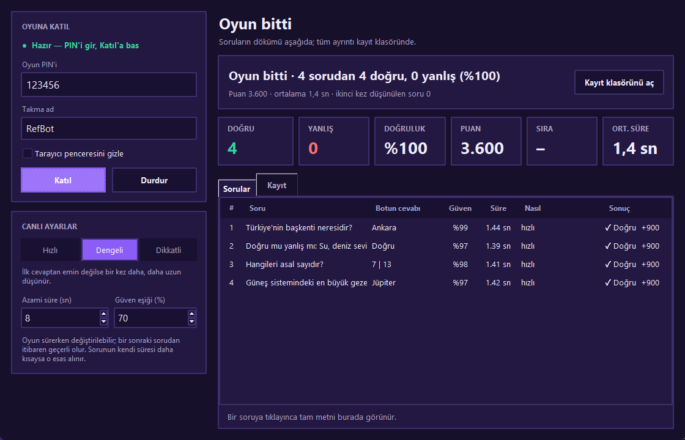
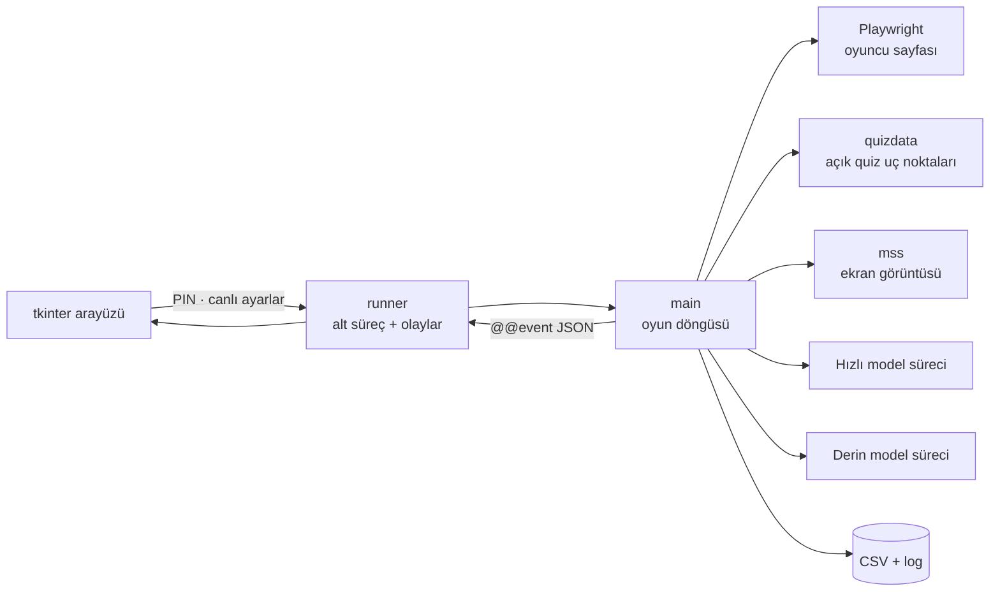

# 🤖 Kahoot Yapay Zekâ Oyuncusu

**Canlı bir Kahoot oyununa tek oyuncu olarak katılan, soruyu farklı kaynaklardan okuyup bir dil modeliyle saniyeler içinde cevaplayan ve her sorunun süre/güven profilini kaydeden "referans bot"**

Çevrimdışı demo oyunu: 4 soru tipi (tek seçim, doğru/yanlış, çoklu seçim, yazılı cevap) ortalama 1,4 saniyede cevaplanıyor.

## Proje hakkında
Bir yapay zekâ oyuncusunun bir sınıf quizinde ne kadar hızlı ve ne kadar doğru cevap verdiğini görmek için geliştirdim. Bot, öğretmenin **kendi oyununa tek bir referans oyuncu** olarak katılır. Oyun sonunda botun süreleri, Kahoot raporundaki öğrenci süreleriyle karşılaştırılabilir.

> Tek oyuncu olarak tasarlanmıştır. Çoklu bot ya da oyunu doldurma (flood) özelliği yoktur ve eklenmeyecektir.

Canlı bir oyunda, host "soruları cihazlarda göster" seçeneğini kapatmışken ve quiz bilgisi verilmemişken bot soruları kendisi buldu. **15 sorunun 14'ünü** doğru cevapladı.

## Özellikler
- **Hızlı katılma**
  - Arayüz açılır açılmaz tarayıcı ve model süreçleri arka planda ısınır.
  - PIN girildikten sonra katılma 1–2 saniye sürer.
- **4 kademeli soru kaynağı:**
  1. cihazdaki soru metni,
  2. Kahoot'un açık uç noktalarından otomatik bulunan quiz içeriği,
  3. oyun başı sunucu mesajı,
  4. host ekranının görüntüsü (görsel girdiyle).
- **Kalıcı model süreci:** Model süreci stream-json modunda sürekli açık tutulur, böylece her soruda yalnızca modelin yanıt süresi ödenir.
- **İki aşamalı düşünme:** Hızlı cevabın güveni eşiğin altındaysa, sürenin kalanında daha derin düşünen ikinci bir süreç devreye girer.
- **Karıştırılmış soru sırası:** Sorular görsel kimliğiyle quiz bloklarına eşlenir.
- **Bilinçli sınır:** Quiz verisindeki cevap anahtarı okunmaz. Bot cevap aramaz, bir yapay zekâ oyuncusu gibi cevaplar.
- **Canlı ayarlar:** Hız modu (hızlı/dengeli/dikkatli), azami süre ve güven eşiği oyun sırasında değiştirilebilir.
- **Kayıt:** Her oyun için CSV (soru, cevap, güven, süre, kaynak), hata ayıklama günlüğü ve modele gönderilen görseller saklanır.

## Mimari

## Nasıl denenir
Gerçek oyuna gerek yoktur. Proje, Kahoot'un oyuncu sayfasıyla aynı seçicileri kullanan çevrimdışı bir **mock oyun** içerir: [`showcase/mock/mock_kahoot.html`](showcase/mock/mock_kahoot.html). Yukarıdaki demo bu sayfayla kaydedildi. Arayüz `--demo` bayrağıyla başlatıldığında bot kahoot.it yerine bu sayfaya bağlanır.

## Kod örnekleri
- [`solver.py`](showcase/solver.py): kalıcı model süreci, prompt kurma ve cevap ayrıştırma.
- [`kahoot.py`](showcase/kahoot.py): Playwright ile katılma, olay algılama, tıklama ve yazma.
- [`quizdata.py`](showcase/quizdata.py): quiz bulma ve canlı soruyu bloğa eşleme.
- [`runner.py`](showcase/runner.py): arayüz ile bot süreci arasındaki olay protokolü ve demo modu.

## Neler öğrendim
- Gecikmeye duyarlı bir sistemde yavaş işleri (tarayıcı, model ısınması) kullanıcı beklemeden önce yapmak.
- Bir web uygulamasının WebSocket trafiğini inceleyip kullanılabilir veriyi çıkarmak.
- Arayüz ile arka plan süreci arasında satır tabanlı, sağlam bir olay protokolü tasarlamak.

---
© Ahmet Emin Arslanbaş — Tüm hakları saklıdır. Eğitim ve araştırma amaçlıdır; yalnızca kendi oyunlarınızda kullanın.
